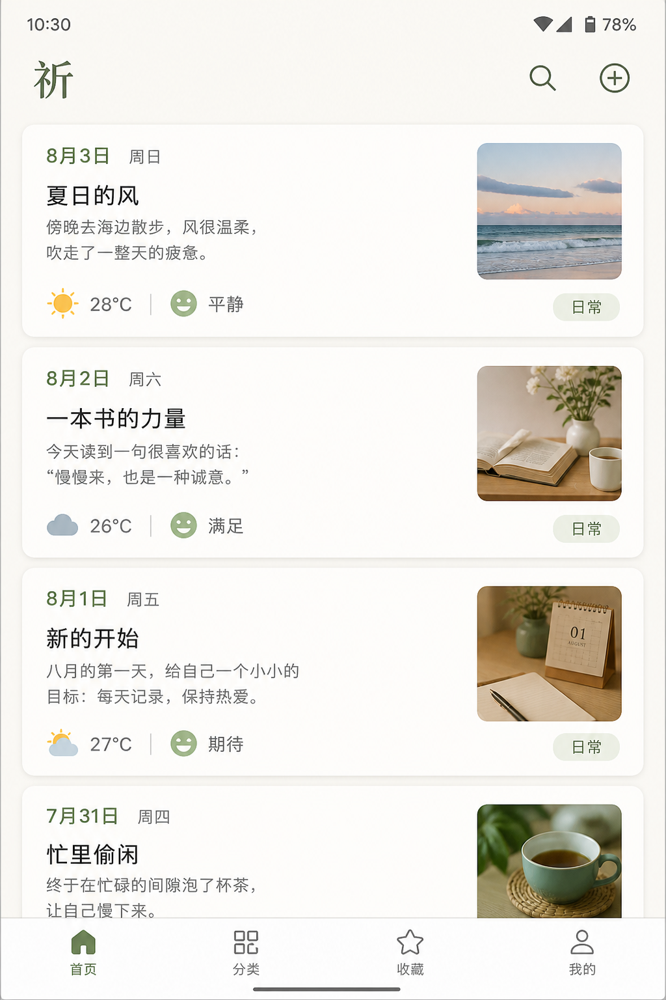

# 更新日志（Changelog）

本文件记录「祈 / Inorinal」的用户可见变更。版本号采用 `Alpha vX.Y.Z` 形式；Git 标签建议为 `vX.Y.Z`。

图片仅作示意，实机界面以安装包为准。

  

---

## [admin v0.1.2] — 2026-11-20

### 新增

- **设置页**：可在登录后查看全部后台管理员、创建新管理员（新账号首次登录仍强制改密），
  并在同一页修改当前管理员密码。
- **外观设置**：每个管理员独立保存主题偏好，支持深色 / 浅色 / 跟随系统。
- **背景三选一**：纯色（自选十六进制颜色）、Bing 每日壁纸、自行上传 JPEG / PNG / WebP（≤4MB）。
- **背景模糊**：0–30px 实时预览；只作用于背景，不影响文字与控件。
- 深色模式下背景自动叠加深色护眼遮罩，浅色模式使用浅色遮罩。
- 自定义背景按管理员存于 `<data_dir>/admin-cache/themes/`，数据库只记录文件名，读取需要 Bearer 会话。

### 界面

- 登录页保持「左介绍 + 右卡片」布局，窄屏隐藏介绍并让登录卡居中。
- 设置页沿用纯色 + 蓝色小圆角体系；背景层固定在后、内容层在前，滚动与弹窗不受影响。
- 页面标题栏增加半透明面板，浅色主题与浅色壁纸下仍保持标题对比度。
- 移动端设置页、管理员表、背景选项与上传控件改为单列布局，无横向溢出。

### 安全

- CSP 的 `img-src` 增加 `blob:`，用于自定义背景的安全预览；仍禁止外部脚本与内联脚本。
- 管理员密码修改后，该管理员的其它会话立即失效。

### 测试

- `.tmp-dev/admin_settings_check.py`：设置页、深浅色、纯色、Bing、上传、创建管理员、
  改密、刷新持久化与 API 校验全部通过，无 console/page 错误。
- `.tmp-dev/admin_e2e.py` 53 项全绿；`server/tests/test_api.py` 23 项全绿。
- `.tmp-dev/admin_mobile_check.py`：390×844 下设置页、创建管理员弹窗与概览无溢出、无报错。

---

## [admin v0.1.1] — 2026-11-20

### 变更

- 深色背景改为 `#121212`；继续使用蓝色主色与小圆角。
- 登录页改为「左侧介绍 + 右侧登录卡片」的两列布局，背景每天跟随 Bing 壁纸更新；
  壁纸由服务端抓取并按日期缓存，失败时回退最近一张，不阻塞登录。
- Excel 导出取消「绑定对象」「角色」两列，由 13 列变为 11 列；页面仍可查看这两项。
- 后台只保留 HTTPS 入口：`http://124.221.102.236/admin*` 由 Caddy 返回 `308`，
  根路径仍归既有站点；HTTPS 由 `https://124.221.102.236/admin/` 提供。

### 安全（code-audit standard）

- 管理页与管理 API 全部补上 `Strict-Transport-Security`、`Permissions-Policy`、
  `Cross-Origin-Resource-Policy`，静态页使用 `no-cache`。
- 改密接口增加旧密码失败限制：15 分钟内 5 次错误后锁定 15 分钟。
- 登录对不存在的管理员执行 dummy scrypt，降低账号枚举的时序差异。
- 用户名 / 密码限制最大长度，超长输入不进入哈希与数据库。
- 拒绝带 `Transfer-Encoding` 的请求体，避免分块编码与 Content-Length 的歧义。
- 封禁 / 解封 / 删除账户改为单事务，避免半完成状态。
- xlsx 文本清洗孤立 UTF-16 代理项，避免导出非法 XML。
- `X-Forwarded-For` 改取最后一跳，防止客户端伪造来源 IP 绕过锁定。
- 审计结论：无 Critical / High，2 个 Medium 与 5 个 Low 已修复或加固。

### 测试

- `.tmp-dev/admin_e2e.py` 53 项全绿；`server/tests/test_api.py` 23 项全绿。
- 手工验证 HSTS/CSP/Permissions-Policy、超长密码 401、连续 5 次旧密码错误后 429。

---

## [admin v0.1.0] — 2026-11-20

### 新增

- **祈 · 账户管理后台**：挂在现有服务端 `/admin` 下，不新增进程与端口。
  - 管理员 `admin / 12345678` 首登强制改密；同 IP 1 小时 10 次失败锁定 1 小时。
  - 账户分页、搜索、状态筛选；查看创建时间、设备、绑定状态、角色、在线状态。
  - 创建 / 删除 / 封禁（10 分钟、1 小时、24 小时、一周、永久）/ 解封账户；封禁立即踢下线。
  - 一键导出真正的 `.xlsx`（13 列，冻结首行 + 筛选）。
  - 开放注册开关（DB 优先于 `INORINAL_OPEN_REGISTRATION`）。
  - 概览统计：请求数、入/出字节、14 天趋势、热门接口、在线设备、运行时长、数据库大小、
    网卡流量，以及最近审计。
- 服务端新增表 `admins`、`admin_sessions`、`admin_login_attempts`、`admin_ip_bans`、
  `server_stats`、`admin_settings`；`users` 增加 `ban_until / ban_reason / ban_at / ban_by`。
- 说明文档：`docs/admin-console.md`。

### 界面

- 生产入口改为 IP 直达：<http://124.221.102.236/admin/>（Caddy 在 IP 站点内把 `/admin*`
  反代到 `127.0.0.1:8095`，根路径仍保留给既有站点）；HTTPS 自签地址继续可用。
- 主题改为纯色 `#212121` 背景 + `#3b82f6` 蓝色主色，取消渐变、光晕、毛玻璃与大圆角，
  控件统一 3–4px 圆角；保留减少动效偏好。
- 移动端账户表改为卡片式布局，侧栏折行，柱状图隔项显示日期；空列表提供「创建账户 / 清除筛选」动作。
- 视觉收尾后复跑 Playwright（桌面 + 390px 移动端），无 console/page 错误。

### 测试

- 新增 `.tmp-dev/admin_e2e.py`：53 项端到端断言（静态页、CSP、首登改密、创建/封禁/解封/删除、
  app 登录拦截、注册开关、xlsx 结构、审计、IP 锁定与解锁、统计埋点）。
- 原有 `server/tests/test_api.py` 23 项保持全绿。

---

## [v0.6.8] — 2026-11-21

### 新增

- **全站公告**：管理后台「公告」面板可以发一句话给所有用户，显示在 App 主页标题下面，
  不弹窗、不推送，到期自动消失，也可以随时清空（默认保留 3 天，可选 1 / 3 / 7 / 30 天）。
- **截屏记录**：主人端在「设备管控中心 → 数据管控 → 截屏记录」里能看到每一次截屏，
  缩略图带时间、点开全屏、可以删除；文件用联结密钥在本机加密，服务器拿不到画面，
  解绑后旧记录显示「已锁定」而不会被偷偷解开。
- **应用更新**：启动时静默检查服务端版本，有新版才提示；「关于」页也可以手动检查。
  下载地址与更新日志都由服务端下发，客户端只负责复制链接／跳浏览器；
  换成网盘直链不用发版 —— 改 `server/app/update.py` 的 `DEFAULT_DOWNLOAD_URL`，
  或部署时设环境变量 `INORINAL_APP_DOWNLOAD_URL`（优先，且只接受 http/https）。
- **应用列表搜索**：主人端「应用限制」不再需要手打包名，直接翻列表搜应用名即可。

### 改进

- **指令不再弹通知**：取位置、看使用时长、全屏消息、锁屏这类操作只写审计与小狗端的
  「最近操作」，只有奖励券会弹提醒；Android 14 以上查看位置仍会先征求小狗同意。
- **通知全部静音**：守望、联动、截屏提示都改成无声通知，不响不震。
- **审计只留 24 小时**：小狗端「最近操作」自动清理超过一天的记录，磁盘占用有上限。
- **应用限制关闭更彻底**：点「我知道了」后自动回到桌面并把被限制的应用放到后台，
  不会一松手又弹回来。
- **通知转发不再无限刷新**：修掉了主人在通知页反复拉取、小狗端跟着反复上报的循环。

### 修复

- **日记长图划不动**：修好日记编辑器双层滚动容器导致的「长图片条目上划没反应」。
- **使用时长偶尔连不上**：小狗端把关键查询收进常驻联动，App 不在前台也能回答。

### 说明

- 公告与更新检查都要连服务器，离线时静默跳过，不打扰使用。
- 截屏记录是本机文件，换机或重装后不会恢复；主人端与小狗端各自只留自己那侧。

### 测试

- `npx tsc --noEmit`、`npx jest`、`npx eslint` 全绿；服务端 `pytest` 全绿。
- 双端真机回归：公告展示、截屏落盘与浏览、应用列表搜索、指令静默、审计 24 小时。

## [v0.6.7] — 2026-11-20

### 新增

- **深色改成纯色画布**：三套深色主题的底色统一成 `#212121`，不再叠环境光晕；卡片、输入框跟着改成中性灰（`#2A2A2A` / `#333333`），文字对比度按 `#F2F2F2` / `#B8B8B8` 重算。
- **无障碍保活**：新增一个能力被限死的无障碍服务（只看「祈自己回到前台」，`canRetrieveWindowContent=false`，不读屏幕、不读输入）。系统把守护服务杀掉后，下次你打开祈就会被拉回来；开关在「权限管控中心 → 无障碍服务」，随时可关。
- 权限管控中心会显示这个服务是否在位（`accessibilityKeepAlive`），文案写清「只用来把守护服务拉回来」。
- 新增 `docs/copy-style.md`：把「祈」的说话方式写成可执行的七条规则（第二人称、短句、句末不加句号、失败也用 QAQ 加安抚、允许自嘲），新文案按这份写。

### 修复

- 「仅使用日记」进过主页之后回不到登录页：「我的 → 联结」里补了一行「登录 / 联结」，点它会退出仅日记模式并回到登录界面。
- 注册时可以再输一遍密码，两次不一致会提示「两次输入的密码不一样，再对一遍呀」并禁用创建按钮——账号名一旦占用就不能重来，这里多一层确认。
- 外观配色回到原版：浅色的草莓波普 / 青柠电流 / 电光蓝调连同一套强调色一起回到改动前，名字也恢复；
  深色继续用纯色 `#212121` 画布与中性灰卡片。「跟随系统」仍然生效：颜色跟随系统深浅色切换，外观里也能单独指定。
- 浅色下的背景光晕回到原强度（不影响文字可读）。

## [v0.6.6] — 2026-11-20

### 修复

- **「服务器返回了无法解析的数据」**：`ApiClientModule.kt` 手动写死了 `Accept-Encoding: gzip`。HttpURLConnection 只有在自己添加这个头时才会透明解压，手动设置后拿到的就是压缩原始字节，JS 侧 `JSON.parse` 必然失败。服务器前面的 Caddy 配了 `encode zstd gzip`，超过阈值的响应（例如加入绑定）会被压缩，所以这个错误时有时无。现在删掉手动头，交给系统解压。
- **「你已经在一个绑定关系里」变成死路**：加入绑定其实已经成功（只是没做安全校验），但上一条让它看起来像失败，用户再点一次就只拿到这句拒绝。`server/app/pairing.py` 现在会说明「和谁绑过、卡在哪一步、去『我的 → 我的身份与联结』继续校验或先解绑」。
- **绑定码被填进邀请码**：两者都是 8 位、同一套字母表，光看格式分不出来。`server/app/auth.py` 现在会查 `pairs.code_hash`，认出「这是绑定码」并回 `invite_is_pair_code`，提示先登录、再到「绑定」页填写。客户端注册页同时把邀请码 label/hint 改成「第一个账号可留空」，并在长度不是 8 位时本地就拦住。
- **登录态看着还在、实际全失败**：`GET /api/v1/pairs/current` 拿到 401 时，`QiProvider.refreshPair` 以前把错误整个吞掉，界面停在「已登录」假象。现在 401 会清会话（token/用户名/配对），自动退回登录页并显示服务端原话。
- **解绑「本地看着解开了、服务器上还绑着」**：`unpair()` 以前 `.catch(()=>null)` 吞错。现在只有服务端确认（含 `alreadyUnpaired` 与 404）才算成功；确认不了就清完本地再抛出一句「本地已解除绑定，但服务器没有确认（…）」。服务端 `unpair` 也变成幂等，第二次返回 `alreadyUnpaired: true`，两端谁先解都成立。
- **对方换机后一直显示「等待对方确认」**：配对数据新增 `peerDeviceMissing`（对方账号在、设备行已删），「我的身份与联结」会提示「对方设备已注销，建议解除绑定后重新配对」。
- **小狗端加入后卡在等待校验**：绑定页原来只在「主人等小狗加入」时轮询，主人确认完小狗端不会自己更新。现在两端只要有未校验配对就每 2.5 秒刷新，连续失败会显示「暂时没连上服务器」并给出「刷新状态」按钮；已经开始校验但还没拿到校验码时给「正在核对安全校验码…」空态，不再是一片空白。
- **绑定码手输容易带空格/短横线**：新增 `pairCode.ts` 的 `normalizePairCode`（只留字母数字并转大写、截断 8 位），输入时即时规范化，凑满 8 位才能提交。
- **注册/登录报错不清**：切模式、改任一字段都会清掉上一条错误，避免「已经改对了但仍显示红字」。
- **服务器地址配错时没有任何提示**：`bootstrap()` 里 `qiApi.configure` 失败现在会显示「连不上服务器：请检查地址、网络，以及证书指纹是否与服务器一致」。
- **冷启动看起像「配对丢了」**：`bootstrap()` 第一次拉配对常常打在网络/DNS 还没就绪的时刻，拿到 `null` 就收工，界面直接停在「绑定」选择页。现在失败会隔 1.2 秒再拉一次；选择页也多了一个「已经绑定过？刷新绑定状态」，可以手动补一次而不用重装。

### 测试

- 新增 `test_join_twice_explains_unverified_state`；`test_pairing_and_sas` 增加提示语断言。
- 新增 `test_binding_code_rejected_as_invite`、`test_unpair_reports_already_unpaired`、`test_session_expired_is_401`。服务端 23 项全绿。
- 新增客户端单测 `__tests__/pairCode.test.ts`（6 项）与 `__tests__/apiClient.test.ts`（5 项，覆盖 401/证书指纹/证书/超时/普通断网文案）。

---

## [v0.6.5] — 2026-11-20

### 修复

- **同一台手机换账号会被永久拒绝**：`server/app/auth.py` 的 `_upsert_device()` 只要发现设备 id 已绑定别的账号就抛 `device_taken`（「该设备已绑定其他账号」）。设备 id 存在本机、退出登录不会清，所以一台手机注册过一个账号后，再用邀请码注册新账号或用别的账号登录都会失败——这正是「小狗端无法通过邀请码登录」的真因。现在只要设备公钥一致（同一安装）就允许改绑，并写 `device_rebind` 审计；公钥不同仍拒绝。
- **注册失败会留下占名的孤儿账号**：`register()` 原先把用户、设备、会话分两次提交，设备冲突时用户行已提交，用户名被永久占住，重试只会得到 `username_taken`。现在设备绑定与会话并入同一事务，失败整体回滚。
- 账号已存在时的提示改为「这个账号已经存在。请切到「登录」用密码登录，不用再填邀请码」。

### 说明

- 登录页补一行说明：邀请码只用于注册新账号，已有账号直接用账号密码登录（换手机也一样）。登录接口本来就不校验邀请码。
- 新增回归测试 `test_device_can_switch_account_when_pubkey_matches`、`test_register_rolls_back_user_when_device_conflicts`（服务端 19 项全绿）。

## [v0.6.4] — 2026-11-20

「创建账号」修复与包名变更。这一版换了应用包名（`com.green.inori`），对手机来说是一个新应用：
旧包的数据**不会**自动迁移，需要重新登录、重新授权；配对关系需要在服务器上重建或沿用同一个账号。

### 变更

- **包名改为 `com.green.inori`**：`applicationId` 由 `com.green.inorinal` 变更（`namespace` 与 Kotlin 包名仍是 `com.inorinal`）。
- **新服务器第一个账号免邀请码**：空数据库上注册不再需要邀请码，方便自己搭服务器时先把第一个身份建起来。
- **可选的开放注册开关**：服务器设置环境变量 `INORINAL_OPEN_REGISTRATION=1` 后，任何人不带邀请码也能注册；不设置则保持「必须邀请码」。配对仍然需要绑定码，开放注册只影响「能不能创建身份」。
- 当前这台服务器（`124-221-102-236`）已开启开放注册，因此真机可以直接注册。

### 修复

- **真机上创建账号总是失败**：根因是服务端强制邀请码，而当时服务器上两个邀请码都已被使用，于是任何注册都被拒绝为「需要有效邀请码」；客户端又把这类错误笼统显示成网络问题。现在服务端给出可操作的中文提示（邀请码缺失 / 已被使用），注册页也标注「新服务器可留空」并在下方说明邀请码规则。
- **证书指纹不匹配被误报成「无法连接服务器」**：`ApiClient.errorMessage` 现在区分「证书指纹不匹配」「证书不可用」「连接超时」三种情况，并按提示引导去填证书指纹或检查端口。

### 已知限制

- 换包名后旧安装的数据不共享；如需保留旧数据，必须先在同一包名下导出（我的 → 导出条目），换包后再导入。
- 旧包（`com.green.inorinal`）如果还装着的手机，需要先在系统设置里撤销它的设备管理器，才能卸载干净。

## [v0.6.3] — 2026-11-19

**轨迹时间轴、使用时长详页、原生定位、应用限制与公网部署**

### 变更

- **主页新增「小狗轨迹」**：位置、出行、屏幕使用按时间倒序合成一条时间轴（左列图标 + 竖线），顶部汇总「共 N 段使用 · M 次移动 · X 分钟屏幕时间」，可翻看往日；「取一次位置」只取一次，不后台常驻定位
- **使用时长改为详情页**：《每天 / 每周》切换、日期翻页与「显示今天」、大号总时长与环比、24 小时柱状图（0/30/60 分钟参考线 + 0:00–24:00 时刻轴）、按分类的时长占比（社交通讯/影音娱乐/音乐电台/游戏/工具/未分类）、「统计详情」应用列表带图标与分钟数
- **定位改为原生执行**：只读命令（`location.get` / `usage.stats` / `permissions.snapshot`）由常驻服务在原生侧直接执行并回执，主人端不必等小狗端把应用切到前台；取点改为 12 秒单次截止，按 GPS → NETWORK → PASSIVE 依次尝试，逆地理先读系统缓存、再 Geocoder、最后 Nominatim 兜底
- **应用限制**：主人可在「设备管控中心 → 应用限制」勾选被禁应用并下发；小狗打开被禁应用时全屏拦截「主人已禁止小狗使用该应用」，可在「我的 → 权限管控中心」一键关掉，关闭状态会同步回主人端；检测用 `UsageStatsManager.queryEvents` 增量轮询（限制开启且亮屏时 1.5 秒/省电档 4 秒），不引入无障碍服务、不加唤醒锁
- **使用数据下探到原生**：新增 `usage.day` / `usage.range` / `usage.sessions` / `apps.list` 四个命令，含按应用分类、会话区间与 48dp 图标；枚举应用用 `<queries>` 意图查询，不申请 `QUERY_ALL_PACKAGES`
- **服务端可部署到公网**：新增 `server/deploy/`（systemd unit、Caddy/Nginx 反代、幂等 `install.sh`），已在 `https://124-221-102-236.sslip.io:8443` 上线；应用默认服务器地址与证书指纹 pin 同步更新，登录页「证书指纹」可覆盖
- **远程锁屏**：设备管控中心新增「远程锁屏」，小狗端由常驻服务直接调 `DevicePolicyManager.lockNow()`（不依赖小狗端应用在前台），成功后写入本机审计 `admin.remoteLock`
- **应用限制改由常驻服务下达**：`app.limit` 也交给原生侧解密并落盘，小狗端应用在后台时限制照样生效；仍是「小狗可自行关闭、主人无法远程重开」
- **通知权限主动申请**：首次启动请求 `POST_NOTIFICATIONS`。此前从未申请，Android 13+ 会静默丢弃全部通知——主人收不到「小狗刚刚查看了你的位置」，小狗也收不到任务与券提醒

### 修复

- 打开对方日记时提示「该日记不存在或已被删除」：本机库查不到时回退到对方的共享条目
- 双端定位取不到点：定位失败不再静默返回空，改为按 provider 顺序重试并在 12 秒内给出明确原因
- 小狗端不打开应用时，主人端的定位/使用时长查询长时间无响应
- 大图条目渲染进程崩溃后的纯文本回退会把 `data:image/...;base64` 原文铺满屏幕：回退前先剥离 `` 与 data URI
- 长包名（如 `com.google.android.apps.nexuslauncher`）在轨迹时间轴里折成两行：改为单行省略
- 撤销设备管理员在 Android 15 上点了没反应：系统已移除 `REMOVE_DEVICE_ADMIN` 入口，改为直接调 `removeActiveAdmin()`

### 已知限制

- 轨迹时间轴依赖「取一次位置」或守护服务按功耗档采样的点，不做持续 GPS；模拟器没有网络 provider 时只能拿到 PASSIVE 缓存点
- 出行条目只有起止两点，标注的「最高」实际等于平均速度
- 应用限制以 1.5 秒轮询识别前台应用，被限制应用在切换瞬间可能有一帧可见
- 应用限制的全屏提示是系统浮层：会主动隐藏非系统浮层的应用（系统设置、部分银行 App）拦不到，本版不引入无障碍服务，因此无解
- 设备管理员只是「锁屏」的许可证，**不具备任何保活能力**；常驻靠前台服务 + 电池优化白名单（见 `docs/react-refactor/v0.6.3-deviceadmin.md`）

## [v0.6.2] — 2026-11-19

**日记回归 WebView、地图与地址、免确认定位、常驻联动通知**

### 变更

- **日记编辑器回归 WebView**：编辑与「TA 的日记」共用同一个编辑器页面，差别只在 `readOnly`；只读页隐藏保存/工具条/面板，正文与图片不可编辑、长按不弹键盘，涂鸦与贴纸照原样显示
- **冷启动更快**：先渲染本地骨架与纯文本首屏，WebView 首次绘制后 120ms 淡入；打点 `[editor-boot]` 记录 `ms` / `navMs` / `sinceMount`
- **多图可滚动**：滚动容器从 `#paper` 上移到文档（`html, body`），图片 `max-width: 100%`；修掉「多张竖图撑满屏幕后滑不动」
- **位置改用 Leaflet + OSM 地图**：离线内置 Leaflet 1.9.4，地址优先取 `getAddressLine(0)` 的中文文本，主文案是地址、经纬度降为小字；瓦片加载失败时保留「在地图里打开（浏览器）」
- **后台定期定位**：守护服务心跳里按功耗档采样（省电 30 分钟 / 智能 10 分钟 / 实时 2 分钟），只用 last-known 坐标、不申请后台位置、不加唤醒锁；轨迹写入 `files/qi/puppy-trail.json` 并在小狗轨迹页合并展示
- **小狗看主人位置免确认**：点一次取一次，主人端只收一条「小狗刚刚查看了你的位置」提示，不再需要主人点确认
- **任务通知走常驻前台服务**：新增 `QiLinkService`（`foregroundServiceType="specialUse"`、启动即前台、`START_STICKY`），原生轮询中继并按明文 `kind` 弹中文通知（新任务 / 任务结果 / 奖励券 / 指令），进程被系统回收后仍能提醒；FCM 仍需 `google-services.json` 与服务端密钥，作为可选通道预留
- **任务报备可附最多 10 张图**：横向缩略图条，可逐张预览与移除；旧任务的首图字段继续兼容
- **弹窗不再被输入法遮挡**：`AppSheet` 监听键盘高度，弹窗整体上移并按可用高度重新计算最大高度
- **「打开权限中心」进应用内页**：小狗端首页该卡片改为打开「我的 → 权限管控中心」，只有应用内页不可用时才回退系统设置
- **设备管控中心精简**：移除「通知」「定位」两个入口（已有独立的通知转发与定位查看），使用时长改为点开独立二级页面（分时柱状图 + Top 应用）

### 修复

- 多图日记在编辑态与只读态都无法下滑
- 只读页会闪出可编辑光标、长按弹出键盘
- 任务通知只在主人在线且中继有消息时偶尔出现，主人下发后小狗端常常收不到
- 输入法弹出后 `AppSheet` 内的输入框与按钮被遮挡

---

## [v0.6.1] — 2026-11-19

**23 项体验改进：通知、管控、日记与可访问性**

### 新增

- **日记原生编辑器**：文字段落、照片插入、手写涂鸦（绘制 / 清空 / 往返保存）、私密与共享切换全在 RN 原生页完成，随输入自动保存；贴纸可在原生页新增（13 个 emoji 面板 / 自选图片贴纸）、拖动摆放、点选删除，位置与旋转按 WebView 编辑器同一格式写回，双端互开一致；贴纸日记不再回退 WebView
- **任务与指令**：主人下达任务（标题 / 说明）；小狗端「我的任务」提交报备，可附一张照片（走加密相册，不占正文上限）；主人验收通过或打回，结果通知对方
- **到达通知**：主人下发任务、小狗提交报备、签发和好券、派发奖励券，都在对端弹一条通知（Android 13+ 需授予通知权限）
- **定时规则**：到点弹全屏通知（而不是仅横幅），可选「两边都响 / 只响主人 / 只响小狗」，并随配对同步
- **小狗轨迹**（主人端）：今日使用时段、位置采样时间轴、位移 > 500 米的出行记录
- **主人位置**（小狗端）：点一次取一次主人当前坐标，主人端会收到提醒并留下审计；地图加载不出来时可一键用浏览器打开
- **授权状态页**（主人端）：逐项展示小狗端 10 项权限的授予状态与最近同步时间
- **分时段使用时长**：设备管控中心里 24 小时柱状图 + 「最忙是 X 点」
- **相册缩略图**：最新 10 张显示真实缩略图，点开仍是原图
- **日记设置**（日记页齿轮）：字体大小、默认字体（衬线 / 无衬线 / 圆体）、默认笔刷（钢笔 / 荧光笔 / 铅笔）
- **显示大小**：全局四档（偏小 / 中等 / 偏大 / 特大，默认中等）
- **私密日记**：单篇可切换「仅自己可见 / 共享给 TA」，私密条目不进入同步，列表显示「私密」角标
- **线下核销**（签发端）：当面核销后由签发方在券详情里点「已经在线下核销」，对方那边的核销入口随即关闭
- **内置头像**：默认头像换成内置的主人 / 小狗立绘，可在「我的 → 头像与昵称」换成自己的照片

### 变更

- 绑定时填写的名字与昵称合并：一处修改，两端同步
- 「打开权限中心」改为直达系统「应用信息 · 祈」，从那里进权限更快
- 服务端同步记录上限由 96 KB 提升到 512 KB，带照片 / 贴纸 / 涂鸦的日记不再整篇同步失败

### 修复

- **涂鸦与贴纸在对方日记里丢失**：只读页现在原生解析并绘制涂鸦笔迹，贴纸与照片一并内联
- **通知转发常失效**：通知队列不再被本应用自己的「祈 · 守护中」常驻通知刷满；同一应用 10 分钟内的重复内容只留一条
- 日记同步失败时不再无声无息，会说明原因
- 位置读取在设备从未定位过时会主动取一次点，而不是直接报错

### 兼容性

- 已在 Android 15（API 35）双模拟器与 Android 11（API 30）实机化验证：Android 11 冷启动、同意页、未联结主页均正常
- Android 13 及以下的截屏授权为「随时查看屏幕」+ 每次通知；Android 14+ 每次都要系统确认

## [v0.6.0] — 2026-11-17

**从单人日记到一对一联结：主人端 / 小狗端 + 自建服务器**

产品定位调整为**一对一情侣角色扮演互动工具**：以「主人 - 小狗」身份约定为基础，做授权式设备管控、双向数据共享与桌面小组件互动；日记保留为其中一个模块。

### 新增

- **双端联结**：同一 APK 内置主人端 / 小狗端；邀请码注册、8 位绑定码 + 六位 SAS 双端核对、随时解绑
- **自建服务器** `server/`：Python 标准库实现，账号 / 邀请码 / 设备公钥 / 配对 / 加密中继 / 日记同步 / 媒体分块 / 和好券 / 在线状态；可完全自托管
- **端到端加密**：ECDH P-256 + HKDF-SHA256 + AES-256-GCM，私钥由 Android Keystore 包裹；服务器只保存密文
- **共享日记**：可选择共享或私密；对方条目只读镜像并显示 `TA` 徽标；支持下拉刷新即时看到对方新写的日记，对方条目与自己的手账同样富文本渲染（图片 / 贴纸 / 涂鸦都在）
- **设备权限中心**：设备管理器 / 使用情况 / 通知使用权 / 悬浮窗 / 电池优化 / 精确闹钟 / 定位 / 照片 / 屏幕共享，逐项由小狗端授予与撤回
- **主人端设备管控中心**：守护状态、使用时长、定位、通知摘要、全屏消息、功耗档位（命令经端到端加密通道下发）
- **小狗端响应配置**：功耗三档、使用时长 / 全屏消息开关、通知转发黑名单；关闭后主人端会收到明确的拒绝理由
- **和好券**：主人签发（Ed25519 签名）、小狗校验与一次性核销、加密备注、CSV 导出、审计
- **奖励券（反向派发）**：小狗端在和好券页派发奖励券，主人校验后领取并写下想要的奖励内容（端到端加密），小狗端能看到这份奖励
- **共享空间**：两端都能贴的便签 / 里程碑，正文端到端加密
- **任务与报备**：主人下达任务 → 小狗提交报备 → 主人验收 / 打回，状态端到端加密同步
- **定时规则**：到点提醒，规则同步到两端；本机用 AlarmManager 排闹钟，一次闹钟一条通知，无常驻服务
- **相册分享**：照片在手机加密后分块上传，只有配对双方能解开；支持删除自己分享的照片
- **通知转发详情**：主人端独立页面，下拉拉取小狗端转发的通知并保留本机历史（可清空）；通知内容不做打码，小狗端会提示风险；转发采用黑名单制（只跳过被屏蔽的应用）
- **全局图片查看器**：手账图片、小狗端截图等统一全屏查看，支持两指 / 双击缩放与单指拖动，长按可保存到本地相册
- **自动规则（小狗端）**：按时间段自动切换功耗档位（如 22:30–07:00 省电），规则镜像进守护服务、在心跳里顺手判断，不加定时器、不额外唤醒；命中时写审计
- **装扮（小狗端）**：头像光环（默认 / 玫瑰 / 薄荷 / 暖金）、主页问候语、桌面小组件标题与副标题，全部只存本机、不同步给对方
- **桌面小组件**：显示当前联结状态，文案可由小狗端在「装扮」里自定义（由 App 推动更新，不独立联网）
- **四板块导航**：主页 / 和好券 / 日记 / 我的；角色化头像与强调色（主人蓝、小狗红）

- 全局图片查看器（WebView 渲染）：全屏黑底、双击放大 ×2.5 / 再次双击还原、双指缩放、放大后单指拖动、长按菜单「保存到本地 / 取消」，保存写入 Pictures/Qi（MediaStore）。
- 只读共享日记改为**原生块渲染**（不再使用 WebView）：标题与富文本 1 秒内出字，图片整幅显示并可点开全局查看器；修复了 Android WebView 静态只读页渲染进程崩溃导致的白屏。
- 手账涂鸦画布：把 backing store 限制在 4096 像素以内，并在只读查看模式下完全跳过画布分配，避免高密度屏上一次性申请数十 MB 位图。
### 功耗

- 受控端只有**一个**前台服务 `PuppyGuardService`；无 WakeLock、无 `setInterval`、无高频闹钟
- 三档功耗（省电 / 智能 / 实时），息屏自适应降频，充电加速，低电量自动降级
- 使用统计、定位、截屏均为**按需查询**，不后台轮转；详见 `docs/react-refactor/v0.6.0-power.md`

### 变更

- 角色英文命名统一为 `puppy / PUPPY`（中文界面仍为「小狗」），服务端表结构随之迁移
- 版本号：`versionName` = `v0.6.0`，`versionCode` = `9`

### 修复
- 对方的共享日记改为原生只读渲染（文字 + 图片块），不再打开 WebView：打开更快，并彻底规避旧版 WebView 在静态页上崩溃导致的空白。

### 已知限制

- 未做保活：App 被杀后守护停止，需用户手动打开恢复
- Android 13 及以下的常驻截屏模式缺少对应真机验证
- 桌面小组件仅显示状态，不支持点击跳转深层页面
- 无障碍权限刻意不申请（避免键鼠监听能力），列表显示为未授权

---

## [Alpha v0.5.3-react] — 2026-11-16

**UI 升级：Apple Music「新发现」式鲜明撞色 + Glass Icons + 动效**

### 变更

- 视觉方向重做：黑底 / 冷白编辑感、Apple Music 式大标题与色块，替换上一版暖色轻拟物；三套配色重做为 **草莓波普 / 青柠电流 / 电光蓝调**
- 首页改为「今天」大标题 + 分类 pill 轨道 + 今日 hero + 最近条目；分类改为两列高饱和磁贴；我的改为彩色 hero 与统计块；底部导航改为浮动玻璃 dock + 滑动指示器
- 全部图形图标替换为 **Nucleo Glass Icons**（42 个语义图标 × 浅/深两套，构建时栅格化为 PNG）；删除 MaterialIcons 字体与码表
- 新增轻量动效：tab 指示器、卡片按压、收藏弹跳、路由视差、搜索淡入、Sheet/Dialog、列表 stagger、骨架 pulse、统计 count-in；全部原生驱动并尊重 reduce-motion
- 新增设计契约 `DESIGN.md`、参考重建稿 `docs/design-references/apple-music-cn-new.DESIGN.md` 与 Glass Icons 文档
- 版本升级：`versionName` = `Alpha v0.5.3-react`，`versionCode` = 8

### 构建信息

- `versionName`：`Alpha v0.5.3-react`
- `versionCode`：`8`
- 应用包名：`com.green.inorinal`

---

## [Alpha v0.5.1-react] — 2026-11-14

**React Native 界面重构版（`react` 分支）**

### 变更

- 界面层由 Jetpack Compose 迁移到 **React Native 0.88 + TypeScript**，保持首页 / 分类 / 收藏 / 我的四个标签页、全屏路由与编辑器布局
- 全新**轻拟物 + 毛玻璃 + 暖色撞色**视觉：柔和双层描边与轻阴影卡片、半透明磨砂顶栏/底栏/面板、珊瑚 / 蜜橘 / 芥末黄 / 松绿 / 莓紫撞色色块；保留樱粉 / 薄荷 / 长春花三套配色与浅色/深色模式，刻意避开蓝紫科技渐变
- 性能取舍：毛玻璃以静态磨砂纹理 + 半透明层模拟，不启用实时模糊，避免滚动与输入掉帧
- 数据层：Room → 应用私有目录 **JSON 条目 + 元数据索引 + 媒体目录**；新增旧版 Room 数据只读迁移（升级后首次启动自动导入）
- 备份：ZIP 格式与 Compose 版保持兼容（`manifest.json` 数组、`media/`、`stickers/`），支持导出/导入
- 编辑器：复用原 `assets/editor` WebView 前端（Atrament / Rough / Moveable）与 LXGW 文楷字体；通过 RN ↔ WebView 消息桥驱动，保留文字样式、涂鸦、照片、贴纸、贴纸库与空内容覆盖保护
- 媒体保存改为 **SHA-256 去重落盘**，修复原实现中重复保存产生孤儿文件的问题
- 原生依赖精简：自建 Kotlin 桥接模块（文件 / 媒体压缩 / 图片选择 / SAF / 迁移）+ `react-native-webview` + JSZip

### 已知差异

- 设置中的「跟随系统」配色风格在 RN 版回退为樱花粉（Android 12 动态取色不可移植）
- 分类页统一使用「情绪」文案（Compose 版分类页为「情感」）
- 界面背景与卡片由渐变/纸质纹理改为轻拟物玻璃质感与暖色撞色

### 构建信息

- `versionName`：`Alpha v0.5.1-react`
- `versionCode`：`7`
- 应用包名：`com.green.inorinal`

---

## [Alpha v0.2.3] — 2026-08-04

**首个公开发布（GitHub Release）**

### 新增

- **可交互贴纸**
  - 支持导入本地图片作为贴纸
  - 选中后可拖动、等比缩放、旋转
  - 选中框旁提供圆形删除按钮
  - 贴纸采用绝对定位，可放置在日记任意位置（文字区域或空白处）
- **用户贴纸库**
  - 导入贴纸默认压缩到约 256KB 以下，进入「已导入贴纸」
  - 跨日记复用；长按可从库中删除（不影响已写入正文的贴纸）
  - 「导出条目」备份 ZIP 增加 `stickers/`，导入时恢复贴纸库
- **空内容覆盖保护**
  - 当非空手账即将被保存为空内容时弹出确认框
  - 「继续保存」（红色）允许清空；「取消」强制恢复受保护内容并退出
- **文档与许可**
  - 仓库采用 GPL-3.0
  - 新增详细 README 与本更新日志，附产品配图

### 修复
- 修复 `editor.js` 贴纸 emoji 编码损坏导致的严重回归：贴纸无法插入、打开日记内容被清空、字体工具全部失效
- 字号规范化时保留字体族与文字颜色，避免改字号冲掉样式
- 缓解近距离贴纸被合并为同一调整框的问题（关闭 Moveable 分组）
- 构建：规避 OneDrive 下 `app/release` 目录锁；关闭 release `lintVital` 以避免 Windows 下 lint 缓存 jar 占用失败

### 依赖 / 第三方

- 编辑器引入 Moveable（见应用内开源许可证页与 `assets/editor/vendor/moveable.min.js`）

### 构建信息

- `versionName`：`Alpha v0.2.3`
- `versionCode`：`6`

  

---

## [Alpha v0.2.1] — 2026-06

### 变更摘要

- 涂鸦引擎重建（Atrament + Rough 相关能力强化）
- 一批 P0 稳健性修复（保存、媒体与编辑器桥接等）

---

## [更早版本] — 2026-06 起

### 奠基能力

- 日记 CRUD、天气 / 心情 / 分类
- 首页、分类、收藏、我的、关于
- Compose Material 3 主题（浅色 / 深色 / 跟随系统）
- WebView 富文本编辑器初版
- 照片插入与本地媒体存储
- ZIP 备份导入导出
- 窄屏（约 300–500dp）布局适配与图片插入修复（后续提交延续）

  

---

## 版本对照

| 版本 | versionCode | 说明 |
|------|-------------|------|
| Alpha v0.5.3-react | 8 | UI 升级：鲜明撞色 + Glass Icons + 动效 |
| Alpha v0.5.1-react | 7 | React Native 重构；数据层迁移 |
| Alpha v0.2.3 | 6 | 首个公开 GitHub Release；贴纸库与空保存保护 |
| Alpha v0.2.1 | 5 | 涂鸦重建与稳健性 |
| 更早 | — | 核心日记与备份 |

---

## 升级说明

从 Alpha v0.2.3（Compose）升级到 Alpha v0.5.3-react：

1. 建议先在旧版「我的 → 导出条目」导出一次 ZIP 备份；
2. 安装新包（同包名覆盖安装，旧数据库会保留）；
3. 首次启动会自动尝试从旧版 Room 数据库迁移日记与媒体；若迁移不完整，可在「我的 → 导入条目」中导入刚才的 ZIP；
4. RN 版不再读取 Room，旧数据库只读保留，可随时回退旧版本。

从 Alpha v0.5.1-react 升级到 v0.5.3-react：

1. 直接覆盖安装即可，条目、媒体、设置与备份格式均不变；
2. 三套配色显示名更新为草莓波普 / 青柠电流 / 电光蓝调，已有设置值继续生效；
3. 若系统开启「减少动态效果」，tab/路由/入场动效会自动降级。

从旧 Alpha 升级到 v0.2.3：

1. 安装新包（建议先导出备份）
2. 旧日记中的浮动贴纸会在打开时尝试迁移为绝对定位
3. 新导入的贴纸会出现在「已导入贴纸」；旧备份若不含 `stickers/` 则仅恢复条目与媒体

---

以本软件献给我最亲爱的小不点儿～
