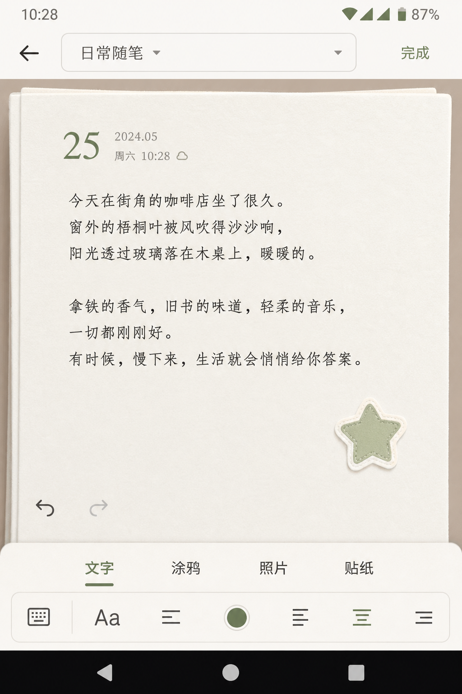

# 更新日志（Changelog）

本文件记录「祈 / Inorinal」的用户可见变更。版本号采用 `Alpha vX.Y.Z` 形式；Git 标签建议为 `vX.Y.Z`。

图片仅作示意，实机界面以安装包为准。

  

---

## [Alpha v0.2.3] — 2026-08-04

**首个公开发布（GitHub Release）**

### 新增

- **可交互贴纸**
  - 支持导入本地图片作为贴纸
  - 选中后可拖动、等比缩放、旋转
  - 选中框旁提供圆形删除按钮
  - 贴纸采用绝对定位，可放置在日记任意位置（文字区域或空白处）
- **用户贴纸库**
  - 导入贴纸默认压缩到约 256KB 以下，进入「已导入贴纸」
  - 跨日记复用；长按可从库中删除（不影响已写入正文的贴纸）
  - 「导出条目」备份 ZIP 增加 `stickers/`，导入时恢复贴纸库
- **空内容覆盖保护**
  - 当非空手账即将被保存为空内容时弹出确认框
  - 「继续保存」（红色）允许清空；「取消」强制恢复受保护内容并退出
- **文档与许可**
  - 仓库采用 GPL-3.0
  - 新增详细 README 与本更新日志，附产品配图

### 修复

- 修复 `editor.js` 贴纸 emoji 编码损坏导致的严重回归：贴纸无法插入、打开日记内容被清空、字体工具全部失效
- 字号规范化时保留字体族与文字颜色，避免改字号冲掉样式
- 缓解近距离贴纸被合并为同一调整框的问题（关闭 Moveable 分组）
- 构建：规避 OneDrive 下 `app/release` 目录锁；关闭 release `lintVital` 以避免 Windows 下 lint 缓存 jar 占用失败

### 依赖 / 第三方

- 编辑器引入 Moveable（见应用内开源许可证页与 `assets/editor/vendor/moveable.min.js`）

### 构建信息

- `versionName`：`Alpha v0.2.3`
- `versionCode`：`6`

  

---

## [Alpha v0.2.1] — 2026-06

### 变更摘要

- 涂鸦引擎重建（Atrament + Rough 相关能力强化）
- 一批 P0 稳健性修复（保存、媒体与编辑器桥接等）

---

## [更早版本] — 2026-06 起

### 奠基能力

- 日记 CRUD、天气 / 心情 / 分类
- 首页、分类、收藏、我的、关于
- Compose Material 3 主题（浅色 / 深色 / 跟随系统）
- WebView 富文本编辑器初版
- 照片插入与本地媒体存储
- ZIP 备份导入导出
- 窄屏（约 300–500dp）布局适配与图片插入修复（后续提交延续）

  

---

## 版本对照

| 版本 | versionCode | 说明 |
|------|-------------|------|
| Alpha v0.2.3 | 6 | 首个公开 GitHub Release；贴纸库与空保存保护 |
| Alpha v0.2.1 | 5 | 涂鸦重建与稳健性 |
| 更早 | — | 核心日记与备份 |

---

## 升级说明

从旧 Alpha 升级到 v0.2.3：

1. 安装新包（建议先导出备份）
2. 旧日记中的浮动贴纸会在打开时尝试迁移为绝对定位
3. 新导入的贴纸会出现在「已导入贴纸」；旧备份若不含 `stickers/` 则仅恢复条目与媒体

---

以本软件献给我最亲爱的小不点儿～
