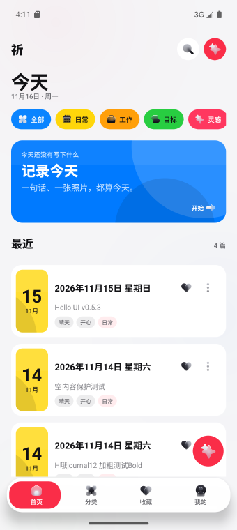
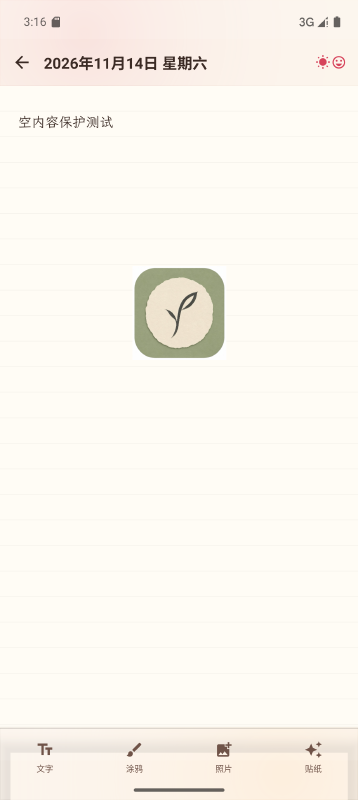

# 祈（Inorinal）

<p align="center">
  
</p>

<p align="center">
  <strong>一款安静、本地优先的 Android 手账日记应用</strong><br/>
  记录天气与心情 · 富文本书写 · 涂鸦与贴纸 · 分类收藏 · 本地备份
</p>

<p align="center">
  
</p>

<p align="center">
  <a href="LICENSE"></a>
  <a href="https://developer.android.com/"></a>
  <a href="#版本更新日志"></a>
</p>

> **分支说明**：本 `react` 分支使用 **React Native 0.88** 重构了应用界面，采用 **Apple Music「新发现」式黑底亮色、轻量玻璃与鲜明撞色** 设计，尽可能保持精简，并保留原有全部功能与布局结构；Jetpack Compose 版本保留在 `main` 分支。
> 版本：**v0.6.1**（versionCode 10）。React Native 应用位于 [`react-native/`](react-native/)，自建服务器位于 [`server/`](server/)。

---

## 目录

- [写在前面](#写在前面)
- [产品定位](#产品定位)
- [功能一览](#功能一览)
- [界面印象](#界面印象)
- [技术架构](#技术架构)
- [隐私与数据](#隐私与数据)
- [构建与运行](#构建与运行)
- [项目结构](#项目结构)
- [开源许可](#开源许可)
- [致谢](#致谢)
- [版本更新日志](#版本更新日志)
- [参与贡献](#参与贡献)

---

## 写在前面

「祈」不是又一个把日记塞进云端、再用算法推送「今日灵感」的效率工具。它更接近一本随身携带的纸质手账：你可以慢慢写，可以随手涂两笔，可以贴一张自己导入的贴纸，也可以什么都不做，只是把今天的天气和心情记下来。

项目英文名 **Inorinal** 来自 inori（祈）与 journal 的结合。应用内品牌名称为「祈」。关于页里有一句很私人的献词——那是作者写给最亲爱的人的。我们把这份温柔保留在开源仓库里，也希望使用者在自己的日常中，找到同样安静的角落。

当前版本为 **v0.6.1**：在 v0.6.0 的「主人 / 小狗」联结、授权式设备管控、共享日记、和好券与共享空间之上，补齐任务与指令、到达通知、全屏定时规则、小狗轨迹、授权状态页、分时段使用时长、相册缩略图、私密日记、显示大小与日记设置等 23 项体验改进。仍属于 Alpha 迭代：交互会继续打磨，稳定性会继续加强，欢迎 Issue 与 Pull Request。

---

## 产品定位

| 维度 | 说明 |
|------|------|
| 平台 | Android 10（API 29）及以上 |
| 形态 | 同一 APK 内置主人端与小狗端，角色由配对关系决定 |
| 联结 | 邀请码注册 + 8 位绑定码 + 六位 SAS 校验；服务器可自托管 |
| 数据 | 本地 JSON 条目库 + 本地媒体目录（`filesDir`）；联结后的共享数据端到端加密 |
| 编辑 | WebView 富文本编辑器（文字 / 涂鸦 / 照片 / 贴纸） |
| 界面 | React Native 0.88，Apple Music 式鲜明撞色 + 轻量玻璃，浅色 / 深色 / 跟随系统 |
| 备份 | ZIP 导出 / 导入，含条目媒体与用户贴纸库，兼容 Compose 版备份格式 |
| 许可 | GNU General Public License v3.0 |

### 三个层次

1. **日记**（默认可用）：本地优先，不登录也能写；分享与否逐篇可控。
2. **联结**（需要自建服务器）：主人端 / 小狗端一对一绑定，共享日记与共享空间。
3. **授权式管控**（逐项由小狗端授予）：屏幕共享、使用时长、定位、通知转发、全屏消息；
   任何一项都能在小狗端随时撤回，主人端无法远程恢复。

加密方式：ECDH P-256 → HKDF-SHA256 → AES-256-GCM，私钥由 Android Keystore 包裹；
服务器只保存密文。和好券卡密由服务器 Ed25519 签名，是唯一的签名例外。

「祈」适合这样的人：

- 想把日记留在自己手机里，而不是交给某个账号体系；
- 喜欢手账感：纸张背景、贴纸、涂鸦，而不是纯 Markdown 冷淡排版；
- 需要分类、收藏、搜索，但仍希望界面克制、不嘈杂；
- 希望应用本身开源，协议清晰，可以审计、可以二次分发（在 GPL-3.0 约束下）。

---

## 功能一览

### 日记与组织

- **首页时间线**：按日期浏览手账卡片，展示标题摘要、天气、心情与分类。
- **分类浏览**：日常、旅行、学习等分类筛选，进入分类条目列表。
- **收藏**：一键收藏重要篇目，在「收藏」页集中回看。
- **搜索**：按关键字检索标题与正文相关内容。
- **元信息**：每篇可设置天气、心情、分类；标题支持默认按日期生成。

### 富文本编辑器

编辑器基于内置 WebView（`assets/editor`），与 Compose 工具栏通过 `EditorBridge` 桥接：

- **文字**：加粗、斜体、下划线、对齐、字体族、字号、颜色等。
- **涂鸦**：Atrament + Rough.js 驱动的涂鸦层，支持笔刷、橡皮、撤销重做、合并到正文。
- **照片**：从相册导入图片，插入日记并纳入条目媒体管理。
- **贴纸**：
  - 内置表情贴纸；
  - 可从本地导入图片贴纸（压缩至约 256KB 以下）；
  - 支持拖动、缩放、旋转与删除；
  - 贴纸可自由放置在日记任意位置；
  - 「已导入贴纸」库跨日记复用；长按可从库中移除（不影响已写入正文的贴纸）。

### 备份与恢复

- 在「我的」中导出全部条目为 ZIP；
- 备份包含 `manifest.json`、条目媒体 `media/...`，以及用户贴纸库 `stickers/...`；
- 导入时可跳过已存在条目，尽量安全合并。

### 联结与装置（v0.6.0）

- **双端联结**：邀请码注册、8 位绑定码、六位 SAS 双端核对；随时解绑，解绑后服务器会删除该配对的密文。
- **共享日记**：逐篇选择私密或共享；对方条目在本机只读呈现（原生块渲染，图片整幅显示、可点开全局查看器），并带 `TA` 徽标。
- **设备权限中心**（小狗端）：设备管理器、使用情况、无障碍（当前不使用）、悬浮窗、电池优化、通知使用权、精确闹钟、定位、照片、屏幕共享，逐项授予与撤回，撤回即时同步给主人。
- **设备管控中心**（主人端）：守护状态与在线电量、使用时长、定位、通知摘要、全屏消息、屏幕截图，命令全部经端到端加密通道下发。
- **响应配置**（小狗端）：功耗三档（省电 / 智能 / 实时）、使用时长与全屏消息开关、通知转发黑名单；关掉后主人会收到明确的拒绝理由。
- **自动规则**（小狗端）：按时间段自动切档，例如 22:30–07:00 省电；规则镜像进守护服务、在心跳里顺手判断，不加定时器、不额外唤醒。
- **装扮**（小狗端）：头像光环、主页问候语、桌面小组件文案，只存本机、不同步。
- **和好券 / 奖励券**：主人签发和好券、小狗派发奖励券；Ed25519 签名、一次性核销、加密备注、CSV 导出与审计。
- **共享空间 / 任务报备 / 定时规则 / 相册分享**：便签与里程碑、下任务到报备验收、到点提醒、加密相册，内容全部端到端加密。
- **桌面小组件**：显示联结状态与自定义文案，由 App 推动更新，不独立联网。

### 体验细节

- 窄屏（约 300–500dp 宽度）布局适配；
- 系统返回与顶栏返回会尝试保存；
- **空内容覆盖保护**：若检测到本有内容的手账即将被存成空白，会弹出确认对话框，避免异常情况下静默清空；
- 首次启动会尝试从旧版（Compose/Room）数据库迁移既有日记与媒体（只读迁移，原数据库保留）。

### React Native 重构说明（本分支）

- 界面层从 Jetpack Compose 迁移到 **React Native 0.88**（TypeScript），保留首页 / 分类 / 收藏 / 我的四个标签页与全部全屏路由、编辑器布局与交互。
- 视觉改为 **Apple Music「新发现」式的黑底亮色、编辑感大字与青绿/红/蓝撞色**：分类磁贴、日期块与统计块使用高饱和实色，顶栏/底栏/工具 dock/Sheet 使用轻量静态玻璃；保留三套配色与深色模式，避开蓝紫科技渐变。全部图形图标改为 Nucleo Glass Icons（构建时栅格化）；动效使用原生驱动的 tab 指示器、按压、路由视差、Sheet 与列表入场。为控制滚动与输入开销，仍不启用实时 blur。
- 数据层由 Room 改为**本地 JSON 条目 + 元数据索引 + 文件媒体目录**，保持 `journal-media://local/<entryId>/<file>` 引用格式，备份 ZIP（`manifest.json` 数组、`media/`、`stickers/`）与 Compose 版本互通。
- 编辑器继续复用 `assets/editor` 下的原 WebView 前端（Atrament / Rough / Moveable）与 LXGW 文楷字体，通过 RN ↔ WebView 消息桥接驱动，功能未削减。
- 原生侧仅保留一个小型桥接模块（文件、媒体压缩、图片选择、SAF 导入导出、媒体迁移）；无重量级 UI 依赖。
- 已知差异：`跟随系统` 配色风格在 RN 版固定回退为樱花粉（Android 12 动态取色不可移植）；分类页统一使用「情绪」文案；收藏夹网格图与 Compose 版保持同一信息结构。

---

## 界面印象

> 下列配图用于说明产品气质与信息架构，部分为示意合成图；实机界面以安装包为准。
>
> 更多截图与设计契约：[`design-language.md`](docs/react-refactor/design-language.md)、[`DESIGN.md`](DESIGN.md)、[`glass-icons.md`](docs/react-refactor/glass-icons.md)。

### 首页

首页采用 Apple Music「新发现」式编辑布局：左上品牌与日期、大字「今天」、高饱和分类轨道、今日 Hero 与最近条目；底部是浮动玻璃 dock。

<p align="center">
  
</p>

### 编辑页

编辑页保留一张可书写的纸：顶部玻璃栏、底部四工具 dock 与文字面板；贴纸仍可拖动、缩放、旋转。

<p align="center">
  
</p>

### 架构鸟瞰

本地优先：React Native 负责导航与面板，JSON + 索引负责条目元数据，WebView 负责正文画布，文件系统负责图片与贴纸库，备份以 ZIP 打包上述内容。

<p align="center">
  
</p>

---

## 技术架构

### 总体分层（react 分支）

```
┌──────────────────────────────────────────────┐
│  UI（React Native 0.88 + TypeScript）        │
│  Home / Category / Favorites / Profile / Editor │
├──────────────────────────────────────────────┤
│  JournalDataProvider · JSON 条目库 · 索引     │
├──────────────────────────────────────────────┤
│  RN 消息桥 ←→ WebView（assets/editor）        │
│  Atrament · Rough.js · Moveable.js           │
├──────────────────────────────────────────────┤
│  InorinalNative：文件 / 媒体压缩 / SAF / 迁移 │
│  JSZip 备份（manifest.json + media + 贴纸）   │
└──────────────────────────────────────────────┘
```

### 关键技术选型

- **语言 / UI**：TypeScript、React Native 0.88（New Architecture / Hermes）
- **持久化**：应用私有目录 JSON 条目 + 索引（原 Room 数据可一次性只读迁移）
- **编辑器**：react-native-webview + 自托管前端资源（与 Compose 版共用）
- **涂鸦**：[Atrament.js](https://github.com/meltingice/atrament.js)、[Rough.js](https://github.com/rough-stuff/rough)
- **贴纸变换**：[Moveable](https://github.com/daybrush/moveable)（vendored 于 `react-native/android/app/src/main/assets/editor/vendor/`）
- **备份**：JSZip + Android Storage Access Framework
- **构建**：Android Gradle Plugin、Gradle 9、NDK 27（New Architecture codegen）

### 编辑器要点

正文 HTML 保存在条目 JSON 的 `content` 字段中。WebView 打开时把 `journal-media://` 引用转换为 base64 展示；保存时由原生桥把内联图片按 SHA-256 去重落盘到 `journal_media/<entryId>/`，再写回本地引用，避免重复保存产生孤儿文件。贴纸以 `.journal-sticker` 节点写入 HTML，位置通过 `left` / `top`（及 data 属性）持久化。用户贴纸库独立存放在应用私有目录 `user_stickers/`，与单篇条目解耦。

自动保存采用 350ms 防抖；退出时再拉取一次最新内容。针对「非空日记被异常写成空 HTML」的情况，退出保存前会弹出红色「继续保存」与「取消」选项：取消将强制恢复受保护内容并退出。

---

## 隐私与数据

- 日记、图片、贴纸默认保存在应用私有存储中。
- 应用**不包含**强制账号登录，也**不以云同步作为默认能力**。
- 导出备份由用户主动触发；请妥善保管 ZIP 文件，其中可能含有个人文字与图片。
- 卸载应用通常会删除私有数据（除非系统备份策略另有规定）；重要内容请定期导出。

我们鼓励把「数据主权」当作产品原则：开源可审计，本地可导出，备份可迁移。

---

## 构建与运行

### 环境要求

- Node.js ≥ 22.11（本仓库使用 Node 24）
- Android Studio Ladybug / 更新版本（或等价 JDK 17/21；Gradle 已固定使用 Android Studio 自带 JBR 21）
- Android SDK Platform 37 / Build-Tools 37、NDK 27.1（New Architecture 代码生成需要）
- 推荐真机或 API 29+ 模拟器

### React Native 应用（`react-native/`）

```bash
cd react-native
npm install

# 调试运行（需同时启动 Metro 并让模拟器可访问 8081）
npx react-native start
adb reverse tcp:8081 tcp:8081
npx react-native run-android

# 直接构建可独立安装的调试包（已内置 JS bundle，无需 Metro）
cd android && ./gradlew :app:assembleDebug

# 直接构建可独立安装的发行包（内置 JS bundle，推荐真机/回归测试）
cd android && ./gradlew :app:assembleRelease
```

APK 输出（构建目录重定向到 `C:/rn-build`，避免 OneDrive 锁文件与 Windows 长路径问题；可用 `INORINAL_BUILD_ROOT` / `INORINAL_CXX_ROOT` 覆盖）：

`C:/rn-build/app/outputs/apk/debug/app-debug.apk`
`C:/rn-build/app/outputs/apk/release/app-release.apk`

安装：

```bash
adb install -r app-debug.apk
```

### 自建服务器（`server/`）

要求 Python 3.11+ 与 `cryptography`：

```bash
pip install cryptography

# 签发注册邀请码（每个账号一个，8 位）
python server/tools/issue_invite.py --data-dir data/dev --count 3

# 启动（默认 8095；数据为 SQLite + 密钥文件）
python server/run.py --host 0.0.0.0 --port 8095 --data-dir data/dev

# 自测
python server/tests/test_api.py
```

客户端首次进入「联结 → 服务器设置」填写地址（模拟器访问本机用 `http://10.0.2.2:8095`）。
发行包默认只允许 HTTPS，请在生产环境用反向代理（Caddy / Nginx）提供 TLS；调试包放开了
`10.0.2.2` / `localhost` 的明文访问，仅供本地联调。

### Jetpack Compose 旧版（`main` 分支）

```bash
./gradlew :app:assembleDebug
```

Windows 示例输出目录：`%LOCALAPPDATA%\Inorinal\gradle-build\app\outputs\apk\debug\`。

---

## 项目结构

```
Inorinal/
├── app/                            # Jetpack Compose 旧版（main 分支保留）
│   ├── build.gradle.kts
│   └── src/main/
│       ├── assets/editor/          # WebView 编辑器与 vendor
│       ├── java/com/green/inorinal/
│       └── res/
├── react-native/                   # React Native 重构版（react 分支）
│   ├── App.tsx                     # 导航 / 主题 / 数据 Provider
│   ├── src/
│   │   ├── components/             # Pop 卡片、玻璃面板、顶栏、对话框、Glass Icons
│   │   ├── data/                   # 条目库、HTML 处理、备份、设置
│   │   ├── editor/                 # WebView 消息桥 shim
│   │   ├── native/                 # Kotlin 原生模块的 TS 封装
│   │   ├── screens/                # 首页 / 分类 / 收藏 / 我的 / 编辑器 / 设置 / 关于
│   │   └── theme/                  # 配色、布局 token、Material 图标码点
│   └── android/
│       └── app/src/main/
│           ├── assets/editor/      # 复用的 WebView 编辑器资源
│           ├── assets/fonts/       # LXGW 文楷 + Material Icons
│           └── java/com/inorinal/nativebridge/  # 原生桥模块
├── docs/
│   ├── images/                     # 自述文档配图
│   └── react-refactor/             # RN 重构规格与构建记录
├── LICENSE                         # GPL-3.0
├── CHANGELOG.md
└── README.md
```

---

## 开源许可

本项目以 **GNU General Public License v3.0** 发布，详见根目录 [`LICENSE`](LICENSE)。

简要理解（非正式法律建议）：

- 你可以自由使用、研究、修改和分发本软件；
- 若你分发修改后的版本，一般需要以 GPL-3.0 开源对应源代码，并保留版权与许可声明；
- 本软件不提供担保。

第三方组件（如 Atrament、Rough、Moveable、AndroidX 等）各有其许可证；应用内「开源许可证」页面亦有汇总。二次分发时请一并遵守这些依赖的许可义务。

---

## 致谢

- 所有在日记与手账传统中默默书写的人；
- Jetpack Compose、Room 与 Android 开源社区；
- 编辑器所使用的优秀前端开源项目维护者；
- 以及每一位愿意提交 Issue、补丁或只是安静使用「祈」的朋友。

<p align="center"><em>以本软件献给我最亲爱的小不点儿～</em></p>

---

## 版本更新日志

完整历史见 [`CHANGELOG.md`](CHANGELOG.md)。

### Alpha v0.5.3-react（UI 升级）

- 视觉重做为 **Apple Music「新发现」式鲜明撞色 + 轻量玻璃**：黑底/冷白编辑感、大标题、分类磁贴、浮动玻璃 dock；三套配色为草莓波普 / 青柠电流 / 电光蓝调
- 全部图形图标替换为 Nucleo Glass Icons（构建时栅格化，浅/深两套）；新增 tab 指示器、按压、收藏弹跳、路由视差、Sheet、stagger、骨架与 count-in 动效
- 新增 `DESIGN.md` 设计契约与 Apple Music 参考重建稿

### Alpha v0.5.1-react（React Native 重构版）

- 界面层迁移到 React Native 0.88 + TypeScript，保留四个标签页、全屏路由与编辑器布局
- 初版 React Native 视觉（轻拟物 + 暖色），后续由 v0.5.3 替换
- 全部功能保留：日记 CRUD、天气/心情/分类、搜索、收藏、分类浏览、JSON/媒体备份导入导出、贴纸库与自由贴纸、涂鸦、照片、字体与颜色、空内容覆盖保护
- 数据层改为本地 JSON + 索引 + 媒体目录，备份 ZIP 与 Compose 版互通
- 新增旧版 Room 日记只读迁移；保存时按 SHA-256 去重媒体文件，消除重复落盘
- 原生依赖精简为自建桥接模块 + react-native-webview

### Alpha v0.2.3（Compose 版，首个公开 GitHub Release）

- 可交互贴纸：导入、拖动、缩放、旋转、删除；自由定位
- 用户贴纸库：≤256KB 压缩、跨日记复用、长按删库、备份导入导出
- 编辑器稳健性：修复脚本编码损坏导致的正文清空 / 字体失效
- 空内容覆盖保护对话框
- 窄屏布局与图片插入相关修复的延续
- 构建：缓解 OneDrive / lint 缓存锁文件问题

### Alpha v0.2.1

- 涂鸦引擎重建与一系列 P0 稳健性修复

### 更早

- 日记核心、分类收藏、备份与编辑器基建

---

## 参与贡献

欢迎通过 GitHub Issue 报告缺陷或提出想法。提交 PR 前请：

1. 说明动机与复现 / 验证方式；
2. 保持改动聚焦，避免无关格式化大爆炸；
3. 若改动编辑器 JS，请注意 **UTF-8 编码**，贴纸 emoji 等建议使用 `\u` 转义，以免在部分 Windows 工具链下再次损坏脚本；
4. 遵守 GPL-3.0。

安全相关问题请负责任地披露，避免在公开 Issue 中粘贴可导致大规模隐私泄露的样本数据。

---

## 路线图（非承诺）

Alpha 阶段可能探索的方向包括：更细的排版样式、贴纸与文字环绕的可选模式、导出为图片 / PDF、更完善的备份校验与冲突策略、无障碍与更大字体模式等。路线图会随使用者反馈调整，不构成交付承诺。

---

**仓库：** [github.com/Green233233/Inorinal](https://github.com/Green233233/Inorinal)  
**当前版本：** v0.6.1  
**许可证：** GPL-3.0
