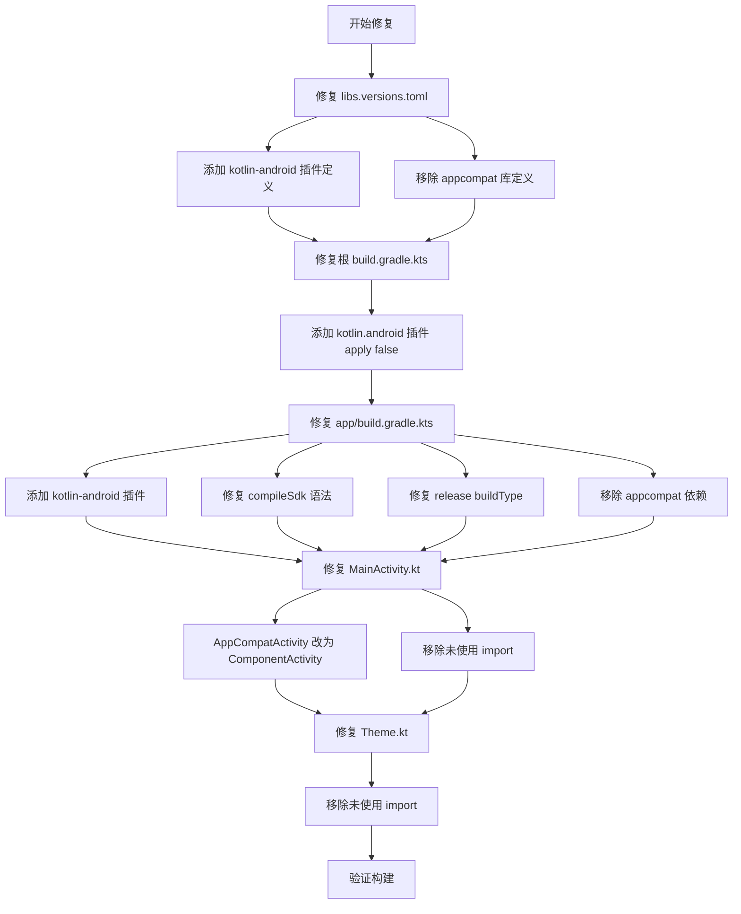

# Inorinal 应用错误修复计划

## 发现的错误总览

通过审查项目所有源文件，发现以下错误：

---

### 错误 1：缺少 `kotlin-android` 插件（严重 - 阻止编译）

**文件**: [`libs.versions.toml`](Inorinal/gradle/libs.versions.toml), [`build.gradle.kts`](Inorinal/build.gradle.kts), [`app/build.gradle.kts`](Inorinal/app/build.gradle.kts)

**问题**: 项目包含 Kotlin 源文件，但未定义和应用 `kotlin-android` 插件。当前只有 `kotlin-compose` 插件，它仅处理 Compose 编译器扩展，不提供基础 Kotlin Android 编译支持。

**修复**:
- 在 `libs.versions.toml` 的 `[plugins]` 中添加: `kotlin-android = { id = "org.jetbrains.kotlin.android", version.ref = "kotlin" }`
- 在根 `build.gradle.kts` 的 plugins 中添加: `alias(libs.plugins.kotlin.android) apply false`
- 在 `app/build.gradle.kts` 的 plugins 中添加: `alias(libs.plugins.kotlin.android)`

---

### 错误 2：`compileSdk` 语法无效（严重 - 阻止编译）

**文件**: [`app/build.gradle.kts`](Inorinal/app/build.gradle.kts:8)

**问题**: 第 8-12 行使用了无效的 DSL 语法：
```kotlin
compileSdk {
    version = release(36) {
        minorApiLevel = 1
    }
}
```
`release(36)` 不是有效的 AGP DSL 函数。

**修复**: 替换为标准语法：
```kotlin
compileSdk = 36
```

---

### 错误 3：`release` buildType 中 `optimization` 语法无效（严重 - 阻止编译）

**文件**: [`app/build.gradle.kts`](Inorinal/app/build.gradle.kts:26)

**问题**: 第 26-28 行：
```kotlin
release {
    optimization {
        enable = false
    }
}
```
`optimization` 块不是 `buildTypes.release` 内的有效 AGP DSL。

**修复**: 移除 `optimization` 块，如需禁用优化，应使用标准属性：
```kotlin
release {
    isMinifyEnabled = false
    isShrinkResources = false
}
```

---

### 错误 4：`AppCompatActivity` 与 Compose 不兼容（重要 - 运行时问题）

**文件**: [`MainActivity.kt`](Inorinal/app/src/main/java/com/green/inorinal/MainActivity.kt:5)

**问题**: 第 5 行和第 23 行：
```kotlin
import androidx.appcompat.app.AppCompatActivity
class MainActivity : AppCompatActivity()
```
使用 Jetpack Compose 的 `setContent` 应搭配 `ComponentActivity`，而非 `AppCompatActivity`。`AppCompatActivity` 是为传统 View 系统设计的，与 Compose 搭配可能导致主题冲突和其他问题。

**修复**:
- 将 import 改为: `import androidx.activity.ComponentActivity`
- 将类声明改为: `class MainActivity : ComponentActivity()`

---

### 错误 5：未使用的 import（次要 - 代码质量）

**文件**: [`MainActivity.kt`](Inorinal/app/src/main/java/com/green/inorinal/MainActivity.kt:21)

**问题**: 第 21 行 `import java.time.LocalDate` 未在代码中使用。

**修复**: 删除该 import 行。

---

### 错误 6：不再需要的 appcompat 依赖（次要 - 代码清理）

**文件**: [`app/build.gradle.kts`](Inorinal/app/build.gradle.kts:52)

**问题**: 第 52 行 `implementation(libs.androidx.appcompat)` — 切换到 `ComponentActivity` 后，appcompat 库不再需要。

**修复**: 删除该依赖行，同时从 `libs.versions.toml` 中删除对应的库定义。

---

### 错误 7：Theme.kt 中的未使用 import（次要 - 代码质量）

**文件**: [`Theme.kt`](Inorinal/app/src/main/java/com/green/inorinal/ui/theme/Theme.kt:3)

**问题**: 以下 import 在简化主题后不再使用：
- 第 3 行: `import android.app.Activity`
- 第 9 行: `import androidx.compose.runtime.SideEffect`
- 第 10 行: `import androidx.compose.ui.graphics.toArgb`
- 第 11 行: `import androidx.compose.ui.platform.LocalView`
- 第 12 行: `import androidx.core.view.WindowCompat`

**修复**: 删除所有未使用的 import。

---

## 修复流程图



## 涉及修改的文件清单

| 文件 | 修改类型 |
|------|----------|
| `gradle/libs.versions.toml` | 添加 kotlin-android 插件，移除 appcompat |
| `build.gradle.kts` | 添加 kotlin.android 插件 |
| `app/build.gradle.kts` | 添加 kotlin-android 插件，修复 compileSdk，修复 release，移除 appcompat |
| `MainActivity.kt` | AppCompatActivity → ComponentActivity，移除未使用 import |
| `ui/theme/Theme.kt` | 移除未使用 import |
