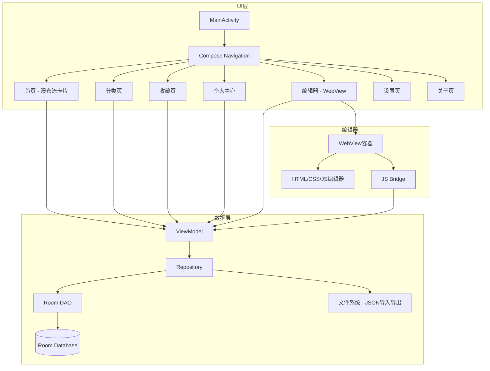
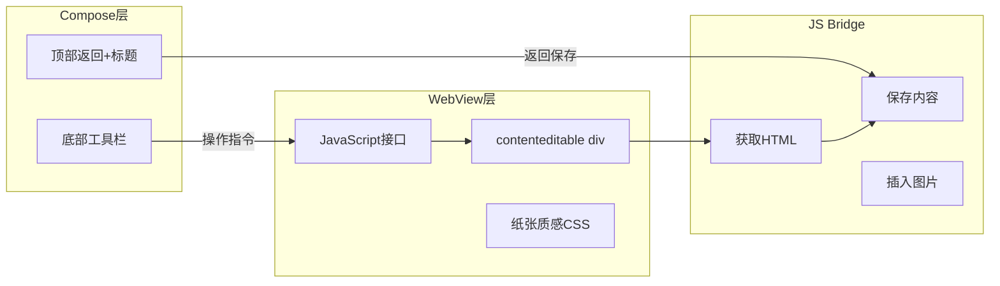
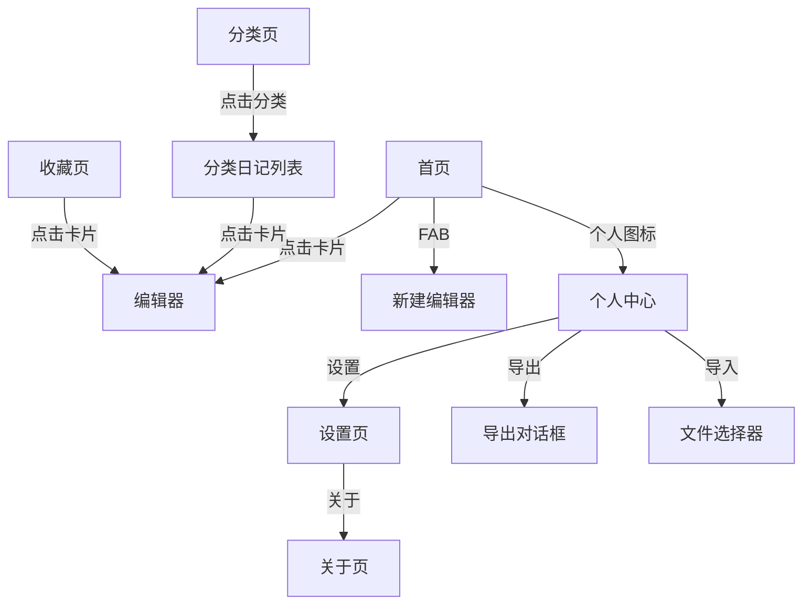

# "祈" 手账本应用完整实施计划

## 一、需求分析总结

根据设计规范，需要将当前占位应用改造为完整的"祈"手账本应用，核心要求：

1. **去除所有 emoji**，替换为 Compose 矢量图形绘制的图标
2. **完善所有占位功能**，使每个按钮和交互都有实际行为
3. **日记编辑器使用 HTML+WebView** 实现复杂精美功能
4. **配色方案**按设计规范调整：主色淡粉 `#FFE6E6`，背景米白 `#FAF7F2`，文字深灰 `#333333`，次要灰 `#999999`

---

## 二、架构设计



---

## 三、分阶段实施计划

### 阶段1：基础设施更新

**目标**：更新配色、应用名称、添加必要依赖

#### 1.1 更新 [`Color.kt`](Inorinal/app/src/main/java/com/green/inorinal/ui/theme/Color.kt)
- 按设计规范调整颜色值：
  - `CherryPink` → `#FFE6E6`（淡粉色主色调）
  - 新增 `RiceWhite = Color(0xFFFAF7F2)`（米白背景）
  - 新增 `LightPink = Color(0xFFFFE6E6)`（淡粉强调色）
  - 新增 `PaleBlue = Color(0xFFE6F3FF)`（淡蓝辅助色）
  - 新增 `PaleGreen = Color(0xFFE6FFE6)`（淡绿辅助色）
  - `DarkGrey` 保持 `#333333`
  - 新增 `SecondaryGrey = Color(0xFF999999)`（次要文字灰）
  - `OffWhite` → `#FAF7F2`（米白背景）

#### 1.2 更新 [`strings.xml`](Inorinal/app/src/main/res/values/strings.xml)
- `app_name` 从 "Inorinal" 改为 "祈"

#### 1.3 更新 [`app/build.gradle.kts`](Inorinal/app/build.gradle.kts)
- 添加依赖：
  - `androidx.navigation:navigation-compose` - 页面导航
  - `androidx.room:room-runtime` + `room-compiler` + `room-ktx` - 数据库
  - `androidx.lifecycle:lifecycle-viewmodel-compose` - ViewModel
  - `androidx.datastore:datastore-preferences` - 设置存储
  - `com.google.accompanist:accompanist-systemuicontroller` - 状态栏控制

#### 1.4 更新 [`Theme.kt`](Inorinal/app/src/main/java/com/green/inorinal/ui/theme/Theme.kt)
- 恢复 `isSystemInDarkTheme` 支持
- 使用新配色方案

---

### 阶段2：矢量图标系统

**目标**：用 Compose Canvas / Vector Drawable 替换所有 emoji

需要替换的 emoji 及对应矢量图标：

| 原 emoji | 用途 | 替换方案 |
|----------|------|----------|
| ☀️ 晴 | 天气-晴 | `Icons.Filled.WbSunny` |
| 🌧️ 雨 | 天气-雨 | `Icons.Filled.WaterDrop` |
| ⛅ 多云 | 天气-多云 | `Icons.Filled.Cloud` |
| 🌙 晴夜 | 天气-夜间晴 | `Icons.Filled.Nightlight` |
| 😊 开心 | 心情-开心 | 自定义 Canvas 笑脸 |
| 😌 平静 | 心情-平静 | 自定义 Canvas 平静脸 |
| 🤩 兴奋 | 心情-兴奋 | 自定义 Canvas 星星眼 |
| 💪 自豪 | 心情-自豪 | `Icons.Filled.FitnessCenter` |
| 🥲 感慨 | 心情-感慨 | 自定义 Canvas 叹息脸 |
| 📖 全部 | 分类-全部 | `Icons.Filled.MenuBook` |
| ☀️ 日常 | 分类-日常 | `Icons.Filled.WbSunny` |
| 💼 工作 | 分类-工作 | `Icons.Filled.Work` |
| 🎯 目标 | 分类-目标 | `Icons.Filled.TrackChanges` |
| 💡 灵感 | 分类-灵感 | `Icons.Filled.Lightbulb` |
| ❤️ 情感 | 分类-情感 | `Icons.Filled.Favorite` |
| 📝 日记 | 统计-日记 | `Icons.Filled.EditNote` |
| 🔥 连续 | 统计-连续 | `Icons.Filled.LocalFireDepartment` |
| ⭐ 收藏 | 统计-收藏 | `Icons.Filled.Star` |
| 👤 头像 | 个人头像 | 自定义 Canvas 云朵图标 |
| 🎨 主题 | 设置-主题 | `Icons.Filled.Palette` |
| 🔔 提醒 | 设置-提醒 | `Icons.Filled.Notifications` |
| ☁️ 备份 | 设置-备份 | `Icons.Filled.CloudUpload` |
| ℹ️ 关于 | 设置-关于 | `Icons.Filled.Info` |

**实现方式**：
- 大部分使用 Material Icons Extended 中已有的图标
- 心情图标（笑脸等）使用 Compose Canvas 自定义绘制
- 云朵头像使用 Compose Canvas Path 绘制

**新建文件**：`IconDrawables.kt` - 包含所有自定义矢量图标绘制函数

---

### 阶段3：数据层

**目标**：Room 数据库 + 数据模型 + 导入导出

#### 3.1 扩展数据模型

更新 [`JournalEntry.kt`](Inorinal/app/src/main/java/com/green/inorinal/JournalEntry.kt)：

```kotlin
data class JournalEntry(
    val id: String,           // UUID
    val title: String,        // 标题
    val content: String,      // HTML内容
    val date: LocalDate,      // 创建日期
    val weather: Weather,     // 天气枚举
    val mood: Mood,           // 心情枚举
    val category: Category,   // 分类枚举
    val isFavorite: Boolean,  // 是否收藏
    val imageUrl: String? = null,
    val createdAt: Long,      // 时间戳
    val updatedAt: Long       // 更新时间戳
)

enum class Weather { SUNNY, RAINY, CLOUDY, NIGHT_CLEAR, SNOWY }
enum class Mood { HAPPY, CALM, EXCITED, PROUD, EMOTIONAL, SAD }
enum class Category { ALL, DAILY, WORK, GOAL, INSPIRATION, EMOTION }
```

#### 3.2 Room 数据库

**新建文件**：
- `data/JournalDao.kt` - DAO接口
- `data/JournalDatabase.kt` - Room数据库定义
- `data/JournalRepository.kt` - 仓库层
- `data/JournalViewModel.kt` - ViewModel

#### 3.3 导入导出

- 导出：将日记序列化为 JSON 文件保存到 Downloads 目录
- 导入：读取 JSON 文件反序列化并插入数据库
- 使用 `Gson` 进行 JSON 序列化

---

### 阶段4：主界面重构

**目标**：卡片式瀑布流布局 + 搜索 + FAB动画

#### 4.1 主界面布局
- 顶部居中显示 "祈" 标题，圆润手写风格字体
- 右上角个人中心图标
- 卡片式瀑布流（使用 `LazyVerticalStaggeredGrid`）
- 每张卡片显示：日期、标题预览、代表性图片、心情矢量图标
- 卡片间距适中，背景米白色
- 右下角渐变粉色圆形 FAB，带放大动画

#### 4.2 搜索功能
- 点击搜索图标展开搜索栏
- 实时过滤日记标题和内容

#### 4.3 新建条目
- 点击 FAB → 生成默认标题 "YYYY年MM月DD日 星期X"
- 导航到编辑器界面

---

### 阶段5：HTML 编辑器

**目标**：WebView + HTML/CSS/JS 实现精美手账编辑器

这是最复杂的部分，使用 WebView 嵌入 HTML 编辑器。

#### 5.1 编辑器架构



#### 5.2 HTML 编辑器资源

**新建文件**：`assets/editor/editor.html` - 编辑器主页面

HTML 编辑器功能：
- **纸张质感背景**：米黄色 + 细微纹理 + 边缘阴影
- **文字编辑**：`document.execCommand` 实现
  - 字体选择（手写体/宋体/黑体）
  - 字号调整（小/中/大/特大）
  - 文字颜色（16色选择器）
  - 段落对齐（左/中/右）
  - 撤销/重做
- **涂鸦功能**：Canvas overlay 实现画笔
  - 笔刷类型（铅笔/钢笔/马克笔/水彩/荧光笔）
  - 24色选择
  - 粗细滑动条
  - 橡皮擦
- **照片插入**：通过 JS Bridge 从相册/相机获取图片后以 base64 插入
- **贴纸功能**：SVG 贴纸库，通过 JS Bridge 传递

#### 5.3 底部工具栏

Compose 实现的底部工具栏，包含：
- 文字编辑按钮（A图标）
- 画笔按钮
- 相机/相册按钮
- 贴纸按钮

点击展开对应的工具面板。

#### 5.4 JS Bridge

**新建文件**：`editor/EditorBridge.kt`
- `@JavascriptInterface` 方法供 JS 调用
- Kotlin 调用 JS 函数通过 `webView.evaluateJavascript`

---

### 阶段6：个人界面

**目标**：云朵头像 + 统计 + 设置 + 关于页

#### 6.1 个人信息区域
- 云朵形状头像（Canvas Path 绘制），内部含 "祈" 字
- 用户名（可编辑，DataStore 存储）
- 三个统计数字：总条目数、本月条目数、连续记录天数

#### 6.2 导入导出按钮
- 两个并排大按钮
- 导出：选择单个/全部 → JSON 文件 → 保存到 Downloads
- 导入：文件选择器 → JSON → 提示覆盖 → 导入

#### 6.3 设置界面

**新建文件**：`ui/screens/SettingsScreen.kt`

设置项：
- 界面设置：主题切换（浅色/深色/樱花粉/薄荷绿/莫奈取色）、字体大小、卡片样式
- 编辑设置：默认字体、默认笔刷、自动保存间隔
- 隐私设置：应用锁（密码/指纹）、隐藏敏感内容
- 其他：清除缓存、检查更新、关于我们

#### 6.4 关于界面

**新建文件**：`ui/screens/AboutScreen.kt`

- 淡粉色渐变背景
- 云朵图标 + "祈" 字
- 版本号 "版本 1.0.0"
- 底部小字："以本软件献给我最亲爱的小不点儿～"（斜体淡灰色）
- 点击版本号5次触发彩蛋：粉色爱心和星星飘落动画

---

### 阶段7：分类与收藏

**目标**：分类标签系统 + 收藏功能

#### 7.1 分类页
- 显示各分类及其日记数量
- 点击分类进入该分类的日记列表
- 分类图标使用矢量图标

#### 7.2 收藏页
- 显示已收藏的日记列表
- 与首页卡片样式一致

---

### 阶段8：导航集成

**目标**：Compose Navigation 串联所有页面

#### 8.1 导航图



#### 8.2 导航定义

**新建文件**：`navigation/AppNavigation.kt`

路由定义：
- `home` - 首页
- `category` - 分类页
- `favorites` - 收藏页
- `profile` - 个人中心
- `editor/{entryId}` - 编辑现有日记
- `editor/new` - 新建日记
- `settings` - 设置页
- `about` - 关于页
- `category/{categoryName}` - 分类日记列表

---

## 四、新建文件清单

| 文件路径 | 用途 |
|----------|------|
| `ui/icons/IconDrawables.kt` | 自定义矢量图标 |
| `data/JournalEntry.kt` | 扩展数据模型（替换现有） |
| `data/JournalDao.kt` | Room DAO |
| `data/JournalDatabase.kt` | Room 数据库 |
| `data/JournalRepository.kt` | 仓库层 |
| `data/JournalViewModel.kt` | ViewModel |
| `ui/screens/HomeScreen.kt` | 首页 |
| `ui/screens/CategoryScreen.kt` | 分类页 |
| `ui/screens/FavoritesScreen.kt` | 收藏页 |
| `ui/screens/ProfileScreen.kt` | 个人中心 |
| `ui/screens/EditorScreen.kt` | 编辑器 |
| `ui/screens/SettingsScreen.kt` | 设置页 |
| `ui/screens/AboutScreen.kt` | 关于页 |
| `ui/components/JournalCard.kt` | 日记卡片组件 |
| `ui/components/WeatherIcon.kt` | 天气图标组件 |
| `ui/components/MoodIcon.kt` | 心情图标组件 |
| `ui/components/CloudAvatar.kt` | 云朵头像组件 |
| `navigation/AppNavigation.kt` | 导航图 |
| `editor/EditorBridge.kt` | JS Bridge |
| `assets/editor/editor.html` | HTML编辑器 |
| `assets/editor/editor.css` | 编辑器样式 |
| `assets/editor/editor.js` | 编辑器脚本 |
| `assets/editor/stickers/` | SVG贴纸资源 |

## 五、修改文件清单

| 文件路径 | 修改内容 |
|----------|----------|
| `app/build.gradle.kts` | 添加依赖 |
| `gradle/libs.versions.toml` | 添加版本目录条目 |
| `ui/theme/Color.kt` | 更新配色 |
| `ui/theme/Theme.kt` | 更新主题 |
| `MainActivity.kt` | 简化为导航入口 |
| `AndroidManifest.xml` | 添加文件读写权限 |

## 六、技术要点

1. **HTML 编辑器**：使用 `WebView` 加载本地 `assets/editor/editor.html`，通过 `contenteditable` 属性实现富文本编辑，通过 `addJavascriptInterface` 实现 Kotlin 与 JS 双向通信
2. **涂鸦功能**：在 HTML 中使用 Canvas overlay，监听 touch 事件实现绘制
3. **贴纸系统**：SVG 贴纸作为 `img` 标签插入，支持拖拽和缩放
4. **数据持久化**：Room 存储日记元数据，HTML 内容以字符串形式存储在数据库中
5. **导入导出**：JSON 格式包含所有字段，图片以 base64 编码
6. **主题切换**：通过 DataStore 存储用户偏好，动态切换 ColorScheme
7. **彩蛋动画**：使用 Compose 动画 API 实现爱心和星星飘落效果
